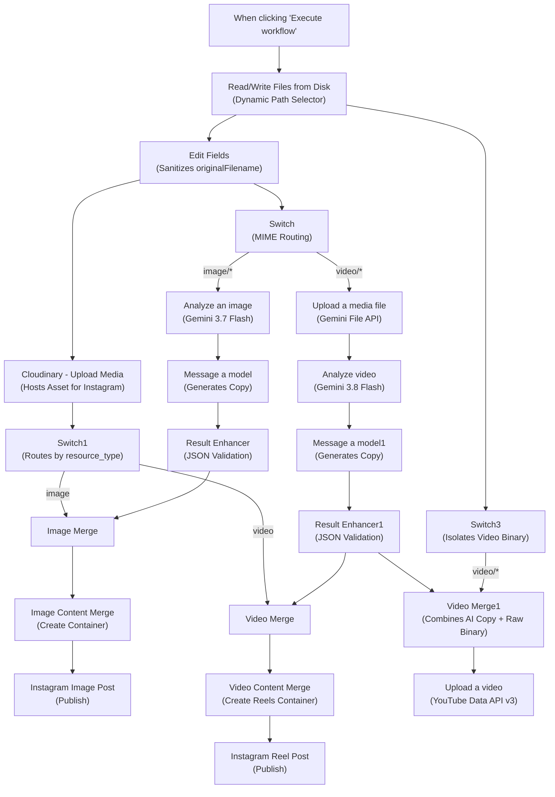

# Content Posting Automation (n8n)

[](https://n8n.io/)
[](https://aistudio.google.com/)
[](https://developers.facebook.com/)
[](https://developers.google.com/youtube/v3)
[](https://cloudinary.com/)
[](https://www.docker.com/)

An enterprise-grade, self-hosted **n8n automation pipeline** that ingests local images and videos, analyzes them multimodally using **Google Gemini**, drafts platform-tailored SEO captions and hashtags, and publishes content directly to **Instagram (Feed Photos & Reels)** and **YouTube**, with full content drafting for **LinkedIn**.

---

## 1. Project Overview & Purpose

Managing multi-channel social media publishing typically requires manually uploading creative assets, watching videos to extract talking points, writing platform-specific copy, generating relevant hashtags, and scheduling posts across separate vendor dashboards.

**Content Posting Automation** replaces this manual overhead with a completely deterministic, self-hosted n8n workflow:

1. **Local File Queue**: Scans a local mounted directory for queued images and videos.
2. **MIME-Based Dynamic Routing**: Automatically distinguishes static images (`image/*`) from video assets (`video/*`).
3. **Multimodal AI Analysis**:
   - Analyzes images directly in binary memory using **Gemini 3.7 Flash**.
   - Uploads videos to the **Google Gemini File API** and performs scene-by-scene and audio dialogue analysis using **Gemini 3.8 Flash**.
4. **Platform-Tailored Copywriting**: Generates structured, fact-checked copy tailored for Instagram, LinkedIn, and YouTube (hooks, captions, hashtags, SEO keywords, tags, titles).
5. **Deterministic Data Normalization**: Validates JSON formatting and cleans code fences via JavaScript Code nodes.
6. **Multi-Channel Publishing**:
   - Stages media via **Cloudinary** and publishes Photos and Reels to **Instagram** via the Meta Graph API.
   - Uploads raw video streams directly to **YouTube** via YouTube Data API v3.

---

## 2. Platform Support Matrix

| Platform | Analysis & Tagging | Copywriting & SEO | Automated Publishing | Notes |
| :--- | :---: | :---: | :---: | :--- |
| **Instagram (Photo)** | :white_check_mark: | :white_check_mark: | :white_check_mark: | Published via Meta Graph API container endpoint. Staged on Cloudinary. |
| **Instagram (Reels)** | :white_check_mark: | :white_check_mark: | :white_check_mark: | Uploaded as Reel with formatted caption, keywords, and CTA. |
| **YouTube** | :white_check_mark: | :white_check_mark: | :white_check_mark: | Direct binary upload via YouTube Data API v3. Uploads as `private` by default. |
| **LinkedIn** | :white_check_mark: | :white_check_mark: | :x: *(Planned)* | Generates professional caption, hashtags, and discussion CTA. **No publishing node currently exists.** |

---

## 3. Technology Stack

- **Workflow Engine**: [n8n](https://n8n.io/) (Self-hosted, Docker-based)
- **AI Models**:
  - `models/gemini-3.7-flash` (Image Analysis & Content Generation)
  - `models/gemini-3.8-flash` (Temporal Video Analysis)
  - Google Gemini File API (Large Media Ingestion)
- **Publishing APIs**:
  - Meta Instagram Graph API v26.0 (Two-stage Container Publishing)
  - YouTube Data API v3 (Multipart Video Upload)
- **Media Hosting**: Cloudinary API (HTTP Multipart Form Upload)
- **Runtime Transformations**: Node.js / JavaScript (n8n Code Nodes v2 & Set Nodes v3.5)
- **Security & Auth**: n8n Credentials Manager, OAuth 2.0, HTTP Basic Auth, Header Auth

---

## 4. Architecture Diagram



---

## 5. Visual Workflow Overview

```
+---------------------------------------------------------------------------------------------------+
|                                     N8N WORKFLOW CANVAS                                          |
|                                                                                                   |
|  [Manual Trigger] -> [Read Files] ---> [Edit Fields] ---> [Cloudinary] ---> [Switch1] ---> [Merge]  |
|                                  |                 |                                              |
|                                  |                 +---> [Switch] ---> [Gemini AI] ---> [Enhancer]|
|                                  |                                                                |
|                                  +---> [Switch3] ------------------------------------> [YouTube]  |
+---------------------------------------------------------------------------------------------------+
```

> **Visual Assets Placeholder**:
> View high-resolution workflow schematics and canvas captures in the [assets/](assets/) directory:
> - `assets/workflow-overview.png`: Full-canvas workflow representation.
> - `assets/workflow-architecture.png`: Branch-level architectural schematic.
> - `assets/setup-screenshots/`: Setup and credential configuration guides.

---

## 6. Quick Installation & Setup

For the complete step-by-step setup walkthrough, read the [docs/SETUP-GUIDE.md](docs/SETUP-GUIDE.md).

### 1. Launch n8n with Docker

**Windows PowerShell:**
```powershell
docker run -d `
  --name n8n `
  --restart unless-stopped `
  -p 5678:5678 `
  -v "D:/n8n_data:/home/node/.n8n" `
  -v "D:/SocialMediaQueue:/files:ro" `
  -e GENERIC_TIMEZONE="Asia/Kolkata" `
  -e TZ="Asia/Kolkata" `
  -e N8N_BLOCK_ENV_ACCESS_IN_NODE="false" `
  -e INPUT_FILES_PATH="/files/*" `
  docker.n8n.io/n8nio/n8n:latest
```

*(Linux/macOS commands and Docker Compose examples are available in [docs/SETUP-GUIDE.md](docs/SETUP-GUIDE.md)).*

### 2. Import the Workflow
1. Open `http://localhost:5678` in your browser.
2. Create your admin account.
3. Click **Workflows** -> **Add Workflow** -> **Import from File**.
4. Select [workflow/Content-Posting-Automation.json](workflow/Content-Posting-Automation.json).

### 3. Connect Credentials
Configure your API keys in the n8n Credentials Manager:
- **Google Gemini(PaLM) Api**: API key from [Google AI Studio](https://aistudio.google.com/).
- **Cloudinary API**: API Key and Secret via HTTP Basic Auth.
- **Meta Instagram API**: Long-Lived Token via HTTP Header Auth.
- **YouTube account**: OAuth 2.0 Client credentials from Google Cloud Console.

### 4. Update Node Placeholders
Replace the following placeholders in the workflow nodes:
- `YOUR_CLOUDINARY_CLOUD_NAME`: In node `Cloudinary - Upload Media `.
- `YOUR_INSTAGRAM_ACCOUNT_ID`: In Instagram HTTP nodes (4 locations).
- `[Your Brand]`: In the prompt for node `Message a model`.

---

## 7. Documentation Navigation

Detailed documentation is available in the `docs/` folder:

| Document | Description |
| :--- | :--- |
| **[docs/SETUP-GUIDE.md](docs/SETUP-GUIDE.md)** | Complete installation guide covering Docker, volumes, and first test run. |
| **[docs/API-CONFIGURATION.md](docs/API-CONFIGURATION.md)** | Step-by-step API credential creation for Gemini, Meta, YouTube, and Cloudinary. |
| **[docs/WORKFLOW-EXPLANATION.md](docs/WORKFLOW-EXPLANATION.md)** | Node-by-node technical audit of all 22 nodes in execution order. |
| **[docs/DIRECTORY-STRUCTURE.md](docs/DIRECTORY-STRUCTURE.md)** | Media queue folder structure, volume mounting, and path expressions. |
| **[docs/TROUBLESHOOTING.md](docs/TROUBLESHOOTING.md)** | Diagnostic guide for common errors, rate limits, and permission issues. |
| **[docs/PRE-DEPLOYMENT-CHECKLIST.md](docs/PRE-DEPLOYMENT-CHECKLIST.md)** | Pre-launch checklist ensuring credentials, paths, and security readiness. |
| **[SECURITY.md](SECURITY.md)** | Security architecture, credential protection, and Git sanitization practices. |
| **[CHANGELOG.md](CHANGELOG.md)** | Version history and feature release notes. |

---

## 8. Known Limitations

1. **LinkedIn Publishing is Not Implemented**:
   The AI models generate full copy for LinkedIn (`$json.linkedin`), but the workflow does not contain a publishing node for LinkedIn. Content must be scheduled manually or sent to a custom webhook.
2. **Instagram Media Requires Public URL**:
   The Meta Graph API cannot read local disk files. Media must be uploaded to Cloudinary first. Free-tier Cloudinary storage and bandwidth limits apply.
3. **Instagram Container Processing Delay**:
   Reels containers occasionally take several seconds to encode on Meta's infrastructure. If publishing fails with `Media container is not ready`, insert a `Wait` node between container creation and publishing.
4. **YouTube Quota Consumption**:
   YouTube Data API v3 enforces a default daily quota of 10,000 units. Each video upload consumes ~1,600 units (approximately 6 video uploads per day).

---

## 9. Contributing

Contributions to enhance the pipeline (such as implementing native LinkedIn publishing, Pinterest support, or batch queuing) are welcome!

1. Fork this repository.
2. Create your feature branch (`git checkout -b feature/linkedin-publisher`).
3. Ensure all sensitive tokens, instance IDs, and local paths are sanitized before exporting the workflow JSON.
4. Commit your changes (`git commit -m 'Add LinkedIn publishing node'`).
5. Push to the branch (`git push origin feature/linkedin-publisher`).
6. Open a Pull Request.

---

## 10. License

See [LICENSE](LICENSE) for terms.

> **Notice:** The repository owner must select and approve a formal software license prior to public distribution.
