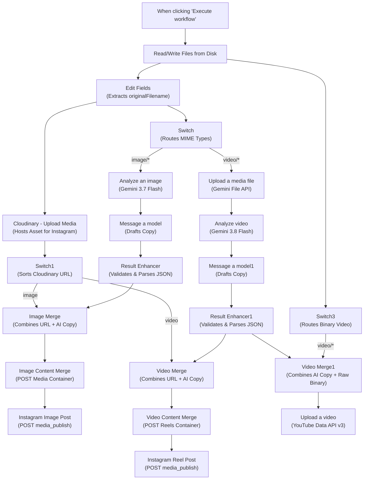

# Complete Workflow Architecture & Node-by-Node Explanation

This document provides a comprehensive technical breakdown of the **Content Posting Automation** n8n workflow. It covers architecture design principles, execution routing, JavaScript code transformations, and an exhaustive audit of all 22 nodes in execution order.

---

## 1. Architectural Design Principles

The workflow operates on three core architectural principles:

1. **Separation of Media Ingestion & Public Hosting**:
   Social media APIs like Instagram Graph API require public HTTPS URLs to ingest media; they cannot read local disk storage. The workflow decouples private local ingestion from publishing by using Cloudinary as an automated temporary staging host for Instagram, while passing raw binary data directly to YouTube Data API v3.
2. **Dual-Track Multimodal AI Pipelines**:
   Google Gemini handles static images and moving videos differently:
   - **Images**: Analyzed directly inline in binary memory via Gemini 3.7 Flash (`Analyze an image`).
   - **Videos**: Uploaded to the Google Gemini File API first via `Upload a media file` to generate a `fileUri`, then analyzed temporally using Gemini 3.8 Flash (`Analyze video`).
3. **Structured Schema Enforcement & Sanitization**:
   AI generation steps are followed by deterministic JavaScript `Code` nodes (`Result Enhancer` and `Result Enhancer1`) that strip markdown fences, parse JSON, enforce presence of required keys (`instagram`, `linkedin`, `youtube`), and attach tracking metadata before publishing.

---

## 2. High-Level Workflow Flowchart



---

## 3. Node-by-Node Detailed Audit (In Execution Sequence)

### Stage 1: Initial Media Input & Metadata Initialization

#### Node 1: `When clicking ‘Execute workflow’`
* **Internal Type**: `n8n-nodes-base.manualTrigger` (v1)
* **Node ID**: `96da8f4c-cde2-4b6e-a4f7-6e00046a03e7`
* **Purpose**: Serves as the manual workflow entry point for user-triggered execution in the n8n GUI.
* **Input Data**: None (Trigger).
* **Output Data**: Empty trigger signal (`{}`).
* **Configuration**: Default manual trigger.
* **Connections**:
  - `main [0]` -> `Read/Write Files from Disk` (Input 0)

#### Node 2: `Read/Write Files from Disk`
* **Internal Type**: `n8n-nodes-base.readWriteFile` (v1.1)
* **Node ID**: `d57c89a4-a8af-4e4a-b85d-0fa79be5c34b`
* **Purpose**: Scans the designated container directory for media files and loads raw binary data into memory.
* **Input Data**: Trigger execution signal.
* **Key Parameter**:
  ```javascript
  "fileSelector": "={{ $env.INPUT_FILES_PATH || '/path/to/your/media/*' }}"
  ```
* **Output Data**: Array of binary items containing:
  - `$binary.data.fileName` (e.g., `clip1.mp4`)
  - `$binary.data.mimeType` (e.g., `video/mp4` or `image/jpeg`)
  - `$binary.data.fileExtension`
* **Connections**:
  - `main [0]` -> `Edit Fields` (Input 0)
  - `main [0]` -> `Switch3` (Input 0)

#### Node 3: `Edit Fields`
* **Internal Type**: `n8n-nodes-base.set` (v3.5)
* **Node ID**: `463f78ef-8c53-43a7-a823-4a19d4ab6009`
* **Purpose**: Computes and stores the base filename (`originalFilename`) by stripping the extension. This string serves as the canonical join key for later Merge nodes.
* **Key Expression**:
  ```javascript
  "originalFilename": "={{ $binary.data.fileName.replace(/\\.[^/.]+$/, '') }}"
  ```
* **Configuration**: `includeOtherFields: true` (ensures binary data passes through untouched).
* **Output Data**: JSON with `originalFilename` alongside original binary properties.
* **Connections**:
  - `main [0]` -> `Cloudinary - Upload Media ` (Input 0)
  - `main [0]` -> `Switch` (Input 0)

---

### Stage 2: Media Classification & Public Hosting

#### Node 4: `Cloudinary - Upload Media `
* **Internal Type**: `n8n-nodes-base.httpRequest` (v4.5)
* **Node ID**: `0a6ce9ce-cc65-4ade-96c1-8126fe9303b3`
* **Purpose**: Uploads media binaries to Cloudinary via HTTP multipart form-data to obtain a publicly accessible HTTPS URL (`secure_url`) required by Instagram Graph API.
* **Credential**: `httpBasicAuth` (`Cloudinary API`)
* **Endpoint**:
  ```http
  POST https://api.cloudinary.com/v1_1/YOUR_CLOUDINARY_CLOUD_NAME/auto/upload
  ```
* **Body Configuration**:
  - `parameterType`: `formBinaryData`
  - `name`: `file`
  - `inputDataFieldName`: `data`
* **Output Data**: Cloudinary JSON payload containing:
  - `secure_url`: Public HTTPS URL of the hosted asset.
  - `resource_type`: `"image"` or `"video"`.
  - `original_filename`: Stripped base filename matching `originalFilename`.
  - `bytes`, `format`, `duration`, `width`, `height`.
* **Connections**:
  - `main [0]` -> `Switch1` (Input 0)

#### Node 5: `Switch1`
* **Internal Type**: `n8n-nodes-base.switch` (v3.5)
* **Node ID**: `f82956d9-d02c-4b4f-8d60-a89fefe296f8`
* **Purpose**: Inspects the Cloudinary response `resource_type` and routes the uploaded asset URL to the appropriate platform Merge node.
* **Rules**:
  - **Output 0 (Video)**: `{{ $json.resource_type }} == 'video'`
  - **Output 1 (Image)**: `{{ $json.resource_type }} == 'image'`
* **Connections**:
  - `main [0]` (Video) -> `Video Merge` (Input 0)
  - `main [1]` (Image) -> `Image Merge` (Input 0)

#### Node 6: `Switch`
* **Internal Type**: `n8n-nodes-base.switch` (v3.5)
* **Node ID**: `e6a936ce-5de8-4a89-8ffc-b896cd016652`
* **Purpose**: Inspects the incoming binary MIME type from `Edit Fields` to dispatch to the appropriate Gemini AI pipeline.
* **Rules**:
  - **Output 0 (Video)**: `{{ $binary.data.mimeType }}` startsWith `"video/"`
  - **Output 1 (Image)**: `{{ $binary.data.mimeType }}` startsWith `"image/"`
* **Connections**:
  - `main [0]` (Video) -> `Upload a media file` (Input 0)
  - `main [1]` (Image) -> `Analyze an image` (Input 0)

---

### Stage 3: Image AI Analysis & Content Generation Pipeline

#### Node 7: `Analyze an image`
* **Internal Type**: `@n8n/n8n-nodes-langchain.googleGemini` (v1.2)
* **Node ID**: `5a0dae28-4329-492d-b13b-c2c4f538df8d`
* **Credential**: `googlePalmApi` (`Google Gemini(PaLM) Api account`)
* **Model**: `models/gemini-3.7-flash`
* **Operation**: `resource: image`, `operation: analyze`, `inputType: binary`
* **Prompt**:
  > *"Describe the image, identify its main subject, visible text, brand or product names, and the intended audience. Do not invent facts that cannot be verified from the image."*
* **Retry Policy**: `retryOnFail: true`
* **Output Data**: JSON containing vision inspection text describing the image.
* **Connections**:
  - `main [0]` -> `Message a model` (Input 0)

#### Node 8: `Message a model`
* **Internal Type**: `@n8n/n8n-nodes-langchain.googleGemini` (v1.2)
* **Node ID**: `d47771e2-8ff5-409a-bed3-fb0b7ee35eb9`
* **Credential**: `googlePalmApi` (`Google Gemini(PaLM) Api account`)
* **Model**: `models/gemini-3.7-flash`
* **Retry Policy**: `retryOnFail: true`, `waitBetweenTries: 1000ms`
* **Key Configuration**: `jsonOutput: true`
* **Prompt Instructions**:
  Instructs Gemini to take `IMAGE ANALYSIS: {{ JSON.stringify($json) }}` and output a pure JSON object containing:
  - `instagram`: Captions, SEO keywords, relevant hashtags, CTA.
  - `linkedin`: 3 professional captions, industry keywords, hashtags, discussion CTA.
  - `youtube`: 3 searchable titles, 3 descriptions, search keywords, video tags, hashtags.
* **Output Data**: Raw text containing valid JSON schema.
* **Connections**:
  - `main [0]` -> `Result Enhancer` (Input 0)

#### Node 9: `Result Enhancer`
* **Internal Type**: `n8n-nodes-base.code` (v2)
* **Node ID**: `6d3dfc4a-1c87-4174-8055-fe3ffaa6a455`
* **Purpose**: Parses the Gemini image copywriting response, combines it with the base filename from `Edit Fields`, and adds an ISO execution timestamp.
* **JavaScript Logic**:
  ```javascript
  const text = $json.content?.parts?.[0]?.text ?? $json.text;
  if (!text) {
    throw new Error('Gemini response text was not found.');
  }
  const result = JSON.parse(text);
  return {
    json: {
      originalFileName: $('Edit Fields').item.json.originalFilename,
      instagram: result.instagram,
      linkedin: result.linkedin,
      youtube: result.youtube,
      processedAt: new Date().toISOString()
    }
  };
  ```
* **Connections**:
  - `main [0]` -> `Image Merge` (Input 1)

---

### Stage 4: Video AI Analysis & Content Generation Pipeline

#### Node 10: `Upload a media file`
* **Internal Type**: `@n8n/n8n-nodes-langchain.googleGemini` (v1.2)
* **Node ID**: `a8b4d95a-ad0d-4832-8c48-c25790134b95`
* **Credential**: `googlePalmApi` (`Google Gemini(PaLM) Api account`)
* **Operation**: `resource: file`, `inputType: binary`
* **Purpose**: Streams the raw video binary to Google's Gemini File API.
* **Output Data**: Object containing `fileUri` (Google Cloud storage pointer).
* **Connections**:
  - `main [0]` -> `Analyze video` (Input 0)

#### Node 11: `Analyze video`
* **Internal Type**: `@n8n/n8n-nodes-langchain.googleGemini` (v1.2)
* **Node ID**: `84d64d68-4ddc-4728-b348-1703c8489f0c`
* **Credential**: `googlePalmApi` (`Google Gemini(PaLM) Api account`)
* **Model**: `models/gemini-3.8-flash`
* **Operation**: `resource: video`, `operation: analyze`
* **Input Video URL**: `={{ $json.fileUri }}`
* **Retry Policy**: `retryOnFail: true`, `maxTries: 5`, `waitBetweenTries: 200ms`
* **Prompt Instructions**:
  Identifies main topic, key message, scenes, actions, visual text, spoken dialogue, target audience, and SEO keywords.
* **Output Data**: Gemini response parts containing video transcript and visual observations.
* **Connections**:
  - `main [0]` -> `Message a model1` (Input 0)

#### Node 12: `Message a model1`
* **Internal Type**: `@n8n/n8n-nodes-langchain.googleGemini` (v1.2)
* **Node ID**: `98fd6deb-6680-4023-9e69-efd0cf5b29de`
* **Credential**: `googlePalmApi` (`Google Gemini(PaLM) Api account`)
* **Model**: `models/gemini-3.7-flash`
* **Key Configuration**: `jsonOutput: true`, `retryOnFail: true`
* **Prompt Instructions**:
  Takes `VIDEO ANALYSIS: {{ JSON.stringify($json.content.parts[0].text) }}` and formats platform-specific content into a strictly validated JSON structure:
  ```json
  {
    "instagram": { "caption": "", "hook": "", "keywords": [], "hashtags": [], "cta": "" },
    "linkedin": { "caption": "", "keywords": [], "hashtags": [], "cta": "" },
    "youtube": { "title": "", "description": "", "keywords": [], "tags": [], "hashtags": [] }
  }
  ```
* **Connections**:
  - `main [0]` -> `Result Enhancer1` (Input 0)

#### Node 13: `Result Enhancer1`
* **Internal Type**: `n8n-nodes-base.code` (v2)
* **Node ID**: `9a1eadd2-c277-4acb-9cba-c5cd77a90be6`
* **Purpose**: Cleans markdown code fences, validates JSON structure, checks for required platform keys, and binds `originalFileName` and timestamp.
* **JavaScript Logic Highlights**:
  ```javascript
  const raw = $json.content?.parts?.[0]?.text ?? $json.text ?? $json.output ?? $json.response;
  const cleaned = String(raw).replace(/^```(?:json)?\s*/i, '').replace(/\s*```$/, '').trim();
  const result = JSON.parse(cleaned);

  for (const platform of ['instagram', 'linkedin', 'youtube']) {
    if (!result[platform]) throw new Error(`Missing ${platform} content.`);
  }

  return {
    json: {
      originalFileName: $('Edit Fields').item.json.originalFilename,
      instagram: result.instagram,
      linkedin: result.linkedin,
      youtube: result.youtube,
      processedAt: new Date().toISOString()
    }
  };
  ```
* **Connections**:
  - `main [0]` -> `Video Merge` (Input 1)
  - `main [0]` -> `Video Merge1` (Input 0)

---

### Stage 5: Merging Data Streams for Instagram Publishing

#### Node 14: `Image Merge`
* **Internal Type**: `n8n-nodes-base.merge` (v3.2)
* **Node ID**: `cbd7d764-0c29-4fff-8a9c-528cdfc020a7`
* **Purpose**: Joins Cloudinary image hosting metadata with AI-generated copy.
* **Mode**: `combine`, `advanced: true`
* **Merge Condition**:
  - `field1`: `original_filename` (from Cloudinary via `Switch1`)
  - `field2`: `originalFileName` (from `Result Enhancer`)
* **Connections**:
  - `main [0]` -> `Image Content Merge` (Input 0)

#### Node 15: `Video Merge`
* **Internal Type**: `n8n-nodes-base.merge` (v3.2)
* **Node ID**: `5ac4bbfa-bc52-49b5-8f3b-e67ab9ab6c87`
* **Purpose**: Joins Cloudinary video hosting metadata with AI-generated copy.
* **Mode**: `combine`, `advanced: true`
* **Merge Condition**:
  - `field1`: `original_filename` (from Cloudinary via `Switch1`)
  - `field2`: `originalFileName` (from `Result Enhancer1`)
* **Connections**:
  - `main [0]` -> `Video Content Merge` (Input 0)

---

### Stage 6: Instagram Publishing Execution

#### Node 16: `Image Content Merge`
* **Internal Type**: `n8n-nodes-base.httpRequest` (v4.5)
* **Node ID**: `58c9b5f0-b69c-4d29-9c21-3414bc750b06`
* **Credential**: `httpHeaderAuth` (`Meta Instagram API`)
* **Endpoint**:
  ```http
  POST https://graph.facebook.com/v26.0/YOUR_INSTAGRAM_ACCOUNT_ID/media
  ```
* **Body Parameters**:
  - `image_url`: `={{ $json.secure_url }}`
  - `caption`: Formats caption, CTA, keywords, and hashtags joined with line breaks.
* **Output Data**: Instagram media container identifier (`{"id": "178..."}`).
* **Connections**:
  - `main [0]` -> `Instagram Image Post ` (Input 0)

#### Node 17: `Instagram Image Post `
* **Internal Type**: `n8n-nodes-base.httpRequest` (v4.5)
* **Node ID**: `66934075-ad60-4434-9bad-1c5967164361`
* **Credential**: `httpHeaderAuth` (`Meta Instagram API`)
* **Endpoint**:
  ```http
  POST https://graph.facebook.com/v26.0/YOUR_INSTAGRAM_ACCOUNT_ID/media_publish
  ```
* **Body Parameters**:
  - `creation_id`: `={{ $json.id }}`
* **Output Data**: Published post ID.
* **Connections**: Terminal (End of Image Instagram branch).

#### Node 18: `Video Content Merge`
* **Internal Type**: `n8n-nodes-base.httpRequest` (v4.5)
* **Node ID**: `55964088-3df1-4fea-8aa3-8714ba71f824`
* **Credential**: `httpHeaderAuth` (`Meta Instagram API`)
* **Endpoint**:
  ```http
  POST https://graph.facebook.com/v26.0/YOUR_INSTAGRAM_ACCOUNT_ID/media
  ```
* **Body Parameters**:
  - `video_url`: `={{ $json.secure_url }}`
  - `caption`: Formatted caption, CTA, keywords, and hashtags.
* **Output Data**: Instagram Reels container identifier (`{"id": "178..."}`).
* **Connections**:
  - `main [0]` -> `Instagram Reel Post ` (Input 0)

#### Node 19: `Instagram Reel Post `
* **Internal Type**: `n8n-nodes-base.httpRequest` (v4.5)
* **Node ID**: `405cf88a-9649-4956-9886-f40105004fb0`
* **Credential**: `httpHeaderAuth` (`Meta Instagram API`)
* **Endpoint**:
  ```http
  POST https://graph.facebook.com/v26.0/YOUR_INSTAGRAM_ACCOUNT_ID/media_publish
  ```
* **Body Parameters**:
  - `creation_id`: `={{ $json.id }}`
* **Output Data**: Published Reel post ID.
* **Connections**: Terminal (End of Video Instagram branch).

---

### Stage 7: YouTube Video Publishing Execution

#### Node 20: `Switch3`
* **Internal Type**: `n8n-nodes-base.switch` (v3.5)
* **Node ID**: `dc2990a3-e732-4ea1-9e99-f1bf8e18aa74`
* **Purpose**: Receives binary data directly from `Read/Write Files from Disk` and isolates video files for direct binary YouTube upload.
* **Rules**:
  - **Output 0 (Video)**: `{{ $binary.data.mimeType }}` startsWith `"video/"` -> Connects to `Video Merge1` (Input 1)
  - **Output 1 (Image)**: Unconnected (Images are ignored by the YouTube publisher).
* **Connections**:
  - `main [0]` -> `Video Merge1` (Input 1)

#### Node 21: `Video Merge1`
* **Internal Type**: `n8n-nodes-base.merge` (v3.2)
* **Node ID**: `0b8587bf-924a-4a3b-b472-b5e8fda2839c`
* **Purpose**: Pairs AI copy (title, description, tags from `Result Enhancer1`) on Input 0 with the raw local binary video from `Switch3` on Input 1.
* **Mode**: `combine`, `combineBy: combineByPosition`
* **Output Data**: Merged item containing both JSON fields (`youtube.title`, `youtube.description`, etc.) and the binary stream `data`.
* **Connections**:
  - `main [0]` -> `Upload a video` (Input 0)

#### Node 22: `Upload a video`
* **Internal Type**: `n8n-nodes-base.youTube` (v1)
* **Node ID**: `5067151c-80bc-41d4-88ec-684d2fa882db`
* **Credential**: `youTubeOAuth2Api` (`YouTube account`)
* **Operation**: `resource: video`, `operation: upload`
* **Key Parameters**:
  - `title`: `={{ $json.youtube.title }}`
  - `regionCode`: `IN`
  - `categoryId`: `28` (Science & Technology)
  - `options.description`: `={{ $json.youtube.description + '\n\n' + $json.youtube.hashtags.join(' ') }}`
  - `options.tags`: `={{ $json.youtube.tags.join(', ') }}`
  - `options.privacyStatus`: `"private"`
* **Output Data**: YouTube video upload confirmation object containing video ID and URL.
* **Connections**: Terminal (End of YouTube branch).

---

## 4. Status of LinkedIn Integration

The workflow nodes `Message a model` and `Message a model1` generate structured copy for LinkedIn:
* Professional caption
* Industry keywords
* Relevant hashtags
* Discussion call-to-action (CTA)

These are sanitized and output into the item JSON by `Result Enhancer` and `Result Enhancer1` as `$json.linkedin`.

> [!IMPORTANT]
> **No LinkedIn publishing node exists in this workflow.** LinkedIn publishing must either be executed manually by copying the generated copy from the execution history, or by adding a dedicated LinkedIn Community Management API node downstream of the Enhancer nodes.
